# 🚀 Awesome Mobile CI/CD & Deployment

<p align="center">
  
</p>

<p align="center">
  <a href="https://github.com/ishandutta2007/Awesome-Awesome-Awesome"></a>
  <a href="https://discord.gg/jc4xtF58Ve"></a>
  <a href="https://github.com/ishandutta2007/Awesome-Mobile-CI-CD-Deployment/stargazers"></a>
  <a href="https://github.com/ishandutta2007/Awesome-Mobile-CI-CD-Deployment/network/members"></a>
  <a href="https://github.com/ishandutta2007/Awesome-Mobile-CI-CD-Deployment/blob/main/LICENSE"></a>
  <a href="https://github.com/ishandutta2007/Awesome-Mobile-CI-CD-Deployment/pulls"></a>
  <a href="https://github.com/ishandutta2007"></a>
</p>

---

### 📱 Curated Ecosystem of Mobile CI/CD Platforms, macOS Runner Farms, iOS Signing Tools & Release Automation

A comprehensive, SEO-optimized guide tracking industry-leading **cloud SaaS platforms** and **open-source developer tools** powering **Mobile Continuous Integration & Continuous Delivery (CI/CD)**. Whether you are shipping native iOS (Swift/Objective-C), Android (Kotlin/Java), cross-platform apps (Flutter, React Native), or managing multi-platform game engines (Unity, Unreal Engine), this repository covers the full journey from code push to TestFlight, Google Play, and enterprise Over-The-Air (OTA) distribution.

> **Key Focus Areas**: Apple Silicon (M2/M3/M4) macOS runners, deterministic iOS code signing via `fastlane match`, provisioning profile rotation, hermetic build caching, automated UI testing, and self-hosted build infrastructure.

---

## 📑 Table of Contents

- [🌐 Sector Overview & Market Dynamics](#-sector-overview--market-dynamics)
- [☁️ SaaS & Hosted CI/CD Platforms](#️-saas--hosted-cicd-platforms)
- [🛠️ Open-Source GitHub Projects](#️-open-source-github-projects)
- [🏗️ Architectural Guide: Mobile CI/CD Pipeline Blueprint](#️-architectural-guide-mobile-cicd-pipeline-blueprint)
- [🤝 How to Contribute](#-how-to-contribute)
- [💖 Support & Sponsoring](#-support--sponsoring)
- [📈 Star History](#-star-history)
- [📜 Disclaimer & License](#-disclaimer--license)

---

## 🌐 Sector Overview & Market Dynamics

The global **Mobile DevOps and CI/CD tooling market** is estimated at **$1.8 Billion – $2.4 Billion in 2026** (within the broader $14+ Billion worldwide DevOps software sector), expanding at an annual growth rate (CAGR) of ~20% as enterprise software portfolios tilt decisively mobile-first.

### Market Concentration & Fragmentation Dynamics:
* **Hybrid Barbell Concentration**: The industry exhibits a distinct two-tier barbell distribution. Hyperscale enterprise repository platforms (**Apple Xcode Cloud**, **Microsoft / GitHub Actions**, **GitLab CI/CD**) capture high concentration among generalist dev teams through built-in repository bundling, deep developer account ties, and consolidated procurement.
* **Resilient Specialized Niche**: Despite cloud platform consolidation, the mobile sector remains **moderately fragmented** because mobile build pipelines face friction foreign to web backend workloads: mandatory bare-metal Apple Silicon macOS hardware virtualization, opaque Apple Developer Portal cryptographic code signing, recurring Xcode major-version SDK deprecations, and mobile binary store ingestion gates. This preserves high-margin defensibility for dedicated mobile CI specialists like **Bitrise** and **Codemagic**.

---

## ☁️ SaaS & Hosted CI/CD Platforms

Below is the comparative breakdown of premier hosted mobile CI/CD platforms, sorted in **descending order by company valuation / annual revenue**:

| Platform | Company Valuation / Revenue | Starting Paid Tier Price | Free Tier Limits / Free Trial Plan | Runner Architecture & Highlights | Best For |
| :--- | :--- | :--- | :--- | :--- | :--- |
| **[Apple Xcode Cloud](https://developer.apple.com/xcode-cloud/)** | **~$3.5 Trillion** Market Cap (FY24 Revenue: $391B+) | **$49.99 / month** (100 compute hours/mo; higher tiers at $99.99/mo for 250 hrs, $399.99/mo for 1,000 hrs) | **25 compute hours / month free forever** included with active Apple Developer Program ($99/year membership); unlimited parallel builds & automatic TestFlight release | Apple-hosted native cloud runners with zero certificate provisioning overhead; directly embedded into Xcode 15/16 and App Store Connect | Small-to-medium native iOS/macOS/watchOS/visionOS engineering teams seeking zero-maintenance Apple-native CI |
| **[GitHub Actions](https://github.com/features/actions)** | **~$3.1 Trillion** Microsoft Market Cap ($245B+ MSFT Revenue; $1B+ GitHub ARR) | **$4.00 / user / month** (GitHub Team, 3,000 min/mo included) or Pay-As-You-Go at **$0.08 / min** (standard 3-core macOS) / **$0.008 / min** (Linux) | **Unlimited free build minutes** for public repositories; **2,000 minutes / month free forever** for private repos (macOS standard 10x multiplier = 200 macOS min/mo), 500 MB GitHub Packages storage | M1 & M2 Pro Apple Silicon hosted runners, massive GitHub Marketplace action ecosystem; requires custom YAML and manual iOS signing configuration | Teams already centralizing source code, security scans, and releases on GitHub wanting unified tooling |
| **[GitLab CI/CD](https://about.gitlab.com/)** | **~$8.5 Billion** Market Cap (NASDAQ: GTLB; $740M+ ARR) | **$29.00 / user / month** (GitLab Premium billed annually at $348/yr; includes 10,000 compute minutes/mo) or additional blocks at **$10 per 1,000 compute units** | **400 compute minutes / month free forever** on GitLab Free; plus a **30-day free trial** of GitLab Ultimate with 10,000 compute minutes and full enterprise DevSecOps features | SaaS macOS runners (`macos-14-xcode-15`), deep container registry integration, and auto-DevOps pipeline compliance controls | Enterprise teams using GitLab for end-to-end source governance, issue tracking, and automated security verification |
| **[CircleCI](https://circleci.com/)** | **~$1.7 Billion** Valuation (Series F, $315M+ funding; ~$100M ARR) | **$15.00 / month** (Performance Plan, includes 30,000 credits/mo and 5 active user seats; compute overages at $0.0006/credit) | **30,000 credits / month free forever** (~3,000 Linux minutes or ~150 macOS M4 Pro medium minutes at 200 credits/min), up to 5 user seats, 1 concurrent job | M4 Pro Apple Silicon compute resources, reusable CircleCI Orbs for Fastlane and mobile test sharding, and smart test splitting | High-velocity engineering organizations requiring aggressive test parallelization and M4 Pro compilation speeds |
| **[Bitrise](https://www.bitrise.io/)** | **~$600 Million** Valuation (Series C, $100M total funding; ~$40M ARR) | **$99.00 / month** (Starter plan with 1 concurrency & expanded credits) or **$192.00 / month** (Pro plan billed annually with dedicated M-series machines) | **300 credits / month free forever** (~150–300 minutes depending on stack), 1 private app, up to 5 concurrent builds, 90-minute maximum build timeout | Mobile-first CI/CD with 400+ pre-built integration steps, visual YAML workflow builder, remote build caching, and Release Management center | Dedicated mobile organizations wanting out-of-the-box mobile steps without managing macOS runner configurations |
| **[Codemagic](https://codemagic.io/)** | **~$35 Million** Valuation (Series A, $4M funding; ~$8M ARR) | **$0.00 / month base + $0.095 / min** Pay-As-You-Go on macOS M2/M4 Apple Silicon (Linux/Windows at $0.045/min), or **$450.00 / month** ($5,400/yr) Fixed Annual Team Plan | **500 build minutes / month free forever** on macOS M2 Apple Silicon VMs (resets 1st of month), 1 concurrency, 120-min timeout, 100k MAU free on Codemagic Patch (CodePush OTA) | Apple Silicon M4 / M2 Mac mini hardware, automated Fastlane integration, automatic iOS code signing without manual certificates, and React Native/Flutter OTA patching | Cross-platform Flutter and React Native teams looking for fast M4 hardware speeds and integrated OTA releases |

---

## 🛠️ Open-Source GitHub Projects

Explore the top open-source tools, CLI utilities, and self-hosted test execution frameworks powering mobile delivery pipelines, ranked in **descending order by GitHub star count**:

### 1. [Fastlane](https://github.com/fastlane/fastlane) [](https://github.com/fastlane/fastlane/stargazers)
* **License**: MIT
* **Primary Role**: The industry-standard automation engine for iOS and Android deployments.
* **Core Capabilities**:
  - `match`: Solves iOS signing hell by storing encrypted certificates and provisioning profiles in a Git repo, Google Cloud Storage, or AWS S3. Keeps entire engineering teams and CI agents synchronized with identical credentials.
  - `gym` / `scan`: Hermetically compiles IPAs and executes XCTest / unit test suites with JUnit formatting.
  - `pilot` & `supply`: Deploys binaries directly to Apple TestFlight and Google Play Console release tracks.
  - `deliver` & `snapshot`: Automates App Store multilingual metadata, localized screenshots, and app review submissions.

### 2. [Appium](https://github.com/appium/appium) [](https://github.com/appium/appium/stargazers)
* **License**: Apache-2.0
* **Primary Role**: Cross-platform mobile test automation framework.
* **Core Capabilities**:
  - Automates native, hybrid, and mobile web applications across iOS, Android, and Windows desktop.
  - Operates over the W3C WebDriver specification, allowing teams to script CI regression tests in TypeScript, Python, Java, or Go.
  - Direct integration with local device USB hubs, cloud testing grids, and simulator pools.

### 3. [Maestro](https://github.com/mobile-dev-inc/maestro) [](https://github.com/mobile-dev-inc/maestro/stargazers)
* **License**: Apache-2.0
* **Primary Role**: Declarative, painless mobile UI test automation for iOS and Android.
* **Core Capabilities**:
  - Eliminates test flakiness with built-in tolerance for animations, network delays, and asynchronous UI updates.
  - Simple, human-readable YAML syntax that can be reviewed in PRs and run effortlessly inside CI runners without heavy WebDriver overhead.
  - Seamless support for React Native, Flutter, Native iOS (SwiftUI/UIKit), and Android (Jetpack Compose).

### 4. [CocoaPods](https://github.com/CocoaPods/CocoaPods) [](https://github.com/CocoaPods/CocoaPods/stargazers)
* **License**: MIT
* **Primary Role**: The veteran Swift and Objective-C dependency manager for Apple projects.
* **Core Capabilities**:
  - Standardizes third-party framework resolution for legacy and modern iOS continuous integration pipelines.
  - Supports deterministic lockfiles (`Podfile.lock`) to ensure repeatable, bit-for-bit identical CI builds across local machines and cloud runners.

### 5. [Detox](https://github.com/wix/Detox) [](https://github.com/wix/Detox/stargazers)
* **License**: MIT
* **Primary Role**: Gray box end-to-end testing and automation library for mobile applications (by Wix).
* **Core Capabilities**:
  - Synchronizes with the app under test at the thread level, waiting for network calls, animations, and database queries to settle before evaluating assertions.
  - Eradicates non-deterministic test failures inside CI/CD pipelines.
  - Highly optimized for React Native and native Android/iOS view hierarchies.

### 6. [Tuist](https://github.com/tuist/tuist) [](https://github.com/tuist/tuist/stargazers)
* **License**: MIT
* **Primary Role**: Xcode project generator and build orchestration engine.
* **Core Capabilities**:
  - Generates modular Xcode project structures on-the-fly, eliminating messy `.pbxproj` git merge conflicts.
  - Provides binary artifact caching: downloads pre-compiled modules from remote cloud caches so CI only builds what has changed.
  - Cuts enterprise iOS CI compilation times by 50% to 80%.

### 7. [Danger](https://github.com/danger/danger) [](https://github.com/danger/danger/stargazers)
* **License**: MIT
* **Primary Role**: Pull request chore automation and team culture enforcer.
* **Core Capabilities**:
  - Inspects mobile PR diffs during CI runs to ensure changelog updates, test additions, and semantic PR guidelines are respected.
  - Posts actionable comments, inline file warnings, and build size delta alerts directly on GitHub, GitLab, and Bitbucket pull requests.

### 8. [xcbeautify](https://github.com/cpisciotta/xcbeautify) [](https://github.com/cpisciotta/xcbeautify/stargazers)
* **License**: MIT
* **Primary Role**: Fast CLI log formatter for `xcodebuild`.
* **Core Capabilities**:
  - Translates massive, unreadable Xcode terminal build logs into clean, human-friendly summaries.
  - Native Swift binary with minimal resource consumption on CI runners.
  - Generates native GitHub Actions workflow commands to render inline compile error annotations on pull request diffs.

### 9. [Zealot](https://github.com/tryzealot/zealot) [](https://github.com/tryzealot/zealot/stargazers)
* **License**: MIT
* **Primary Role**: Self-hosted Over-The-Air (OTA) beta application distribution platform.
* **Core Capabilities**:
  - Open-source, private cloud alternative to Apple TestFlight and retired Microsoft App Center.
  - Supports iOS, Android, macOS, Linux, and Windows build binaries.
  - Automatically parses IPA/APK metadata, synchronizes test device UDIDs with the Apple Developer Portal, and provides Fastlane plugins for automated uploads.

### 10. [Sentry CLI](https://github.com/getsentry/sentry-cli) [](https://github.com/getsentry/sentry-cli/stargazers)
* **License**: BSD-3-Clause
* **Primary Role**: Release orchestration and symbolication utility.
* **Core Capabilities**:
  - Integrates into mobile CI/CD pipelines to automatically extract and upload iOS `dSYM` debug symbol archives and Android ProGuard / R8 mapping files.
  - Associates release versions with git commit hashes for precise crash triaging and performance tracking.

### 11. [Flank](https://github.com/Flank/flank) [](https://github.com/Flank/flank/stargazers)
* **License**: Apache-2.0
* **Primary Role**: Massively parallel Android and iOS test runner for Firebase Test Lab.
* **Core Capabilities**:
  - Intelligently shards XCTest and Espresso test matrices across dozens of cloud devices simultaneously.
  - Re-runs failed tests automatically to distinguish genuine regressions from intermittent hardware flakes.

### 12. [rules_apple](https://github.com/bazelbuild/rules_apple) [](https://github.com/bazelbuild/rules_apple/stargazers)
* **License**: Apache-2.0
* **Primary Role**: Bazel build rules for Apple platforms.
* **Core Capabilities**:
  - Enables hermetic, reproducible compilation, packaging, and code signing for iOS, macOS, watchOS, and tvOS apps at massive scale.
  - Integrates with distributed remote build caches to achieve sub-minute build turnarounds for large engineering organizations.

### 13. [Oore CI](https://github.com/oore-ci/oore.build) [](https://github.com/oore-ci/oore.build/stargazers)
* **License**: MIT
* **Primary Role**: Self-hosted, Flutter-first mobile CI runner and distribution daemon.
* **Core Capabilities**:
  - Lightweight daemon (`oored`) and CLI (`oore`) that turns any on-premise Mac mini into a dedicated mobile build worker.
  - Provides a built-in web portal for internal beta distribution and role-based device orchestration.

---

## 🏗️ Architectural Guide: Mobile CI/CD Pipeline Blueprint

Building an enterprise-grade mobile deployment pipeline requires coordinating five essential layers:

```
┌─────────────────┐     ┌───────────────────┐     ┌───────────────────┐     ┌────────────────────┐     ┌─────────────────────┐
│  1. Code Push   │ ──> │ 2. Build & Test   │ ──> │ 3. Cryptographic  │ ──> │ 4. Binary Packaging│ ──> │ 5. Store Delivery   │
│                 │     │                   │     │    Signing        │     │                    │     │    & Beta Distro    │
│ • GitHub/GitLab │     │ • Tuist / Gradle  │     │ • Fastlane Match  │     │ • xcbeautify / gym │     │ • TestFlight / Play │
│ • Danger Checks │     │ • Maestro / Detox │     │ • KMS / Secrets   │     │ • Sentry dSYMs     │     │ • Zealot (Self-host)│
└─────────────────┘     └───────────────────┘     └───────────────────┘     └────────────────────┘     └─────────────────────┘
```

### Key Engineering Practices:
1. **Solve Code Signing First**: Never rely on ad-hoc manual certificates on CI runners. Adopt **Fastlane match** with an encrypted remote repository and enforce `readonly: true` in CI environments to prevent accidental certificate revocation.
2. **Apple Silicon Hardware Acceleration**: iOS builds depend heavily on single-core CPU clock speeds and memory bandwidth. Running on Apple Silicon (M2/M3/M4) runners cuts clean build times by 40%–60% compared to legacy Intel runners.
3. **Decouple Compilation from Distribution**: Run unit tests and linting on ephemeral pull request runners. Trigger expensive signing, dSYM symbol uploads, and store distribution lanes only on release tags or protected main branches.

---

## 🤝 How to Contribute

Contributions to expand and refine this ecosystem directory are warmly welcomed!

1. 🍴 **Fork the Repository** on GitHub.
2. 🌿 **Create a Feature Branch**: `git checkout -b feature/add-new-mobile-tool`.
3. 📝 **Add Your Entry**:
   - For **SaaS platforms**: Add to the SaaS table including exact starting tier pricing, explicit free tier limits, and valuation/revenue metrics.
   - For **Open-Source projects**: Include project name, shields.io star badge (`style=social&color=white` linking to stargazers), license, and key capabilities.
4. 🧪 **Verify Formatting**: Ensure markdown table syntax and anchor links render properly.
5. 🚀 **Submit a Pull Request**: Provide a brief summary of why the tool is valuable to the mobile engineering community.

---

## 💖 Support & Sponsoring

If this curated mobile CI/CD directory saves your team hours of deployment debugging and infrastructure research, please consider supporting the project:

- ⭐ **Star this repository** to improve visibility and help other mobile developers locate reliable deployment tooling.
- 🍴 **Fork and share** with fellow iOS, Android, Flutter, and React Native developers on social channels and engineering workspaces.
- ☕ **Sponsor the Maintainer**: Support ongoing curation, benchmark updates, and open-source tooling on the [GitHub Sponsors Dashboard](https://github.com/sponsors/ishandutta2007).

---

## 📈 Star History

[](https://star-history.dera.page/#ishandutta2007/Awesome-Mobile-CI-CD-Deployment&type=date&legend=top-left)

---

## 📜 Disclaimer & License

- **Disclaimer**: This is an independent, community-maintained directory. Product names, logos, and brands are property of their respective owners. Performance metrics and pricing details reflect published vendor figures as of 2026.
- **License**: Released under the [MIT License](LICENSE).
